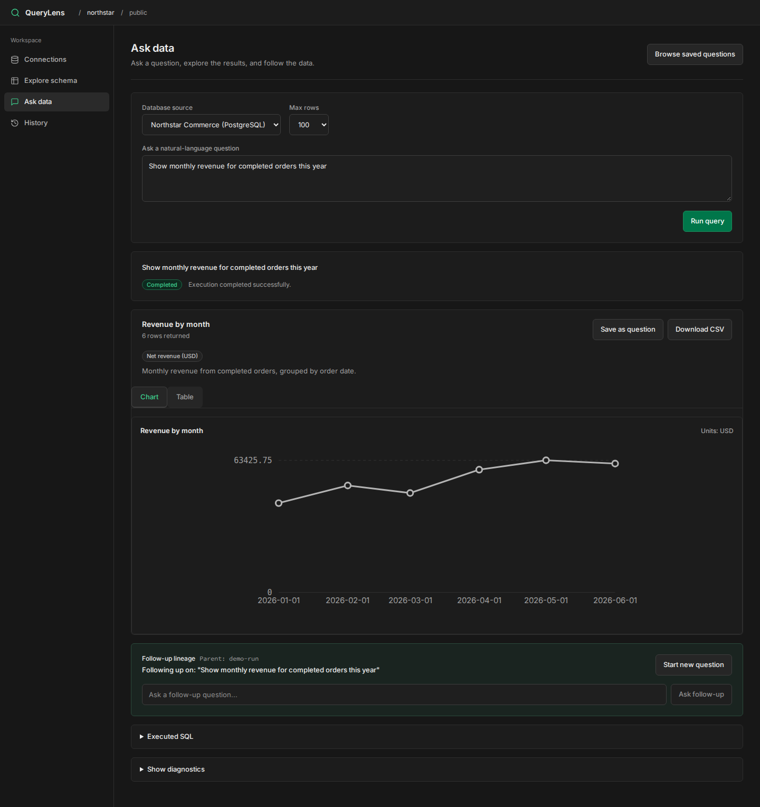
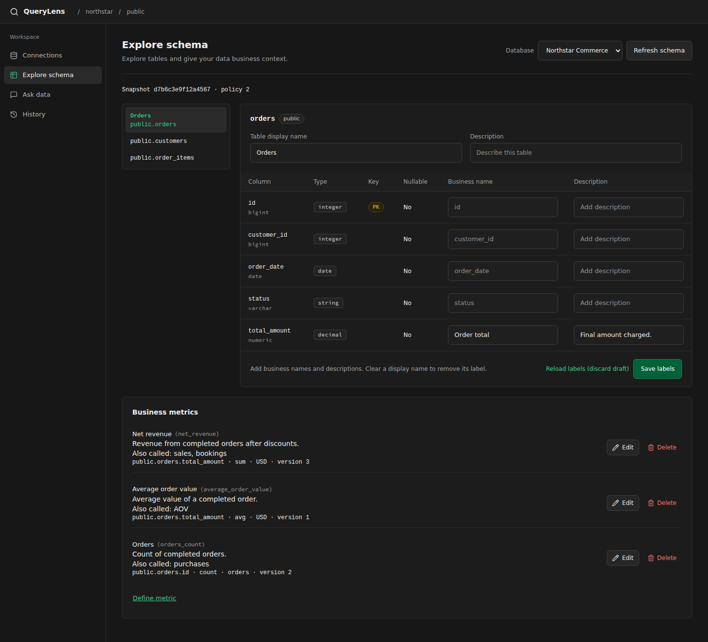

# QueryLens

**Ask your PostgreSQL or MySQL database questions in plain language.** QueryLens generates read-only SQL and presents the results as charts or tables, with the SQL, assumptions, and warnings available for review.

[Quickstart](#quickstart) · [First query](#your-first-query) · [Configuration](CONFIGURATION.md) · [Contributing](CONTRIBUTING.md)



*Synthetic demo data. No real customer or database information is shown.*

## Why QueryLens?

- **Inspect every answer.** Review generated SQL, assumptions, warnings, and diagnostics. Write or edit read-only SQL directly when you need more control.
- **Define what your business means.** Give tables and columns friendly names and define reusable metrics with synonyms, filters, units, and aggregations.
- **Work across PostgreSQL and MySQL.** Import schemas, choose visible tables and columns, and configure connection security.
- **Continue your analysis.** Ask follow-up questions, save questions for reuse, browse query history, and export available rows to CSV.

**Current status:** QueryLens is a self-hosted, shared workspace without sign-in. Anyone who can reach your instance can view and change its connections and history. Run it only where access is restricted to trusted users.

## Quickstart

You need **Python 3.12+**, **Node.js 20**, and **npm 10**. You also need access to a PostgreSQL or MySQL source database to query data. Docker is optional for local sample databases; PowerShell is optional for the repository's verification scripts.

The steps below run the API and frontend on your machine. Development metadata uses a local SQLite file by default; PostgreSQL is required for production metadata.

### 1. Clone and create a Python environment

**macOS / Linux (Bash):**

```bash
git clone https://github.com/SheyBoiCarti/QueryLens.git
cd QueryLens
python3 -m venv .venv
source .venv/bin/activate
cp .env.example .env
```

**Windows (PowerShell):**

```powershell
git clone https://github.com/SheyBoiCarti/QueryLens.git
cd QueryLens
py -3.12 -m venv .venv
.\.venv\Scripts\Activate.ps1
Copy-Item .env.example .env
```

### 2. Install dependencies and configure credentials

With the virtual environment active, run from the repository root in either shell:

```bash
python -m pip install -r apps/api/requirements.lock
python -m pip install -e apps/api
npm ci
python -c "import json, secrets; from pathlib import Path; p = Path('local.keyring.json'); p.exists() or p.write_text(json.dumps({'keys': {'local': secrets.token_hex(32)}}), encoding='utf-8')"
```

Add these lines to `.env` to use the generated credential encryption key:

```dotenv
CREDENTIAL_KEYS_FILE=local.keyring.json
CREDENTIAL_ACTIVE_KEY_ID=local
```

For natural-language questions, also fill in the existing `LLM_PROVIDER`, `LLM_MODEL`, and `LLM_API_KEY` entries. Supported providers are `openai`, `groq`, `openrouter`, and `live` (an OpenAI-compatible endpoint). Use a model identifier supported by your provider; hosted providers may charge for API usage. Manual SQL works without an LLM provider.

Keep `.env` and `local.keyring.json` private. Both are ignored by Git. Preserve the keyring alongside your metadata database so saved connection passwords remain decryptable.

### 3. Start the API and frontend

In the terminal with the Python environment active:

```bash
python -m uvicorn querylens.main:app --host 127.0.0.1 --port 8000 --reload
```

In a second terminal, from the repository root:

```bash
npm run dev --workspace=apps/web
```

Open the app at **<http://localhost:5173>**. The API runs at <http://127.0.0.1:8000>, with interactive documentation at <http://127.0.0.1:8000/docs>. Development startup applies metadata migrations automatically. Stop each server with `Ctrl+C`.

## Your first query

1. Open **Connections** and add a PostgreSQL or MySQL database using a read-only account. If you need sample data, follow the [local PostgreSQL example](CONFIGURATION.md#sample-postgresql-database).
2. Review the imported schema and choose which tables and columns the workspace can access.
3. Open **Ask data**, select the source, and ask a question about its visible columns. With the sample dataset, try **“Show total revenue from completed orders by month in 2024.”**
4. Review the chart or table and expand **Executed SQL** to inspect the query. Save the question, download the available rows as CSV, or ask a follow-up.

### Give questions business meaning

In **Explore schema**, add business labels and define metrics so recurring terms have an explicit meaning. For an `orders` table, for example:

| Metric | Definition | Example question |
|---|---|---|
| Completed revenue | `SUM(orders.total_amount)` where `status = 'completed'`, in USD; synonym: “sales” | “Show monthly sales in 2024.” |
| Average order value | `AVG(orders.total_amount)` where `status = 'completed'`, in USD; synonym: “AOV” | “What was our AOV by month in 2024?” |

These are examples to create in the metric editor, not preinstalled metrics. Answers include the verified metric definition when it is used.

<details>
<summary>See the schema and metrics workspace</summary>



*Synthetic Northstar Commerce data.*

</details>

## How it works

```text
Question + visible schema + business definitions
                      ↓
             LLM proposes SQL
                      ↓
      SQL policy validates and bounds it
                      ↓
       PostgreSQL or MySQL executes it
                      ↓
    Chart or table + SQL + answer metadata
```

The model receives schema context and business definitions, not database credentials. QueryLens validates the proposed SQL and executes it through its own database adapters.

## Security and limitations

- **Use least-privilege, read-only database accounts.** The SQL policy also rejects writes, schema changes, locking reads, recursive CTEs, and other unsupported constructs; it applies a function allowlist and row limits. See the [policy implementation](apps/api/src/querylens/sql/) and [security tests](apps/api/tests/security/).
- Saved source passwords use AES-256-GCM encryption with the configured keyring. Network destination checks and address pinning reduce server-side request forgery risk.
- Query result rows are held temporarily in process memory. They expire or can be evicted; CSV export depends on those rows still being available and neutralizes spreadsheet formula prefixes.
- Natural-language SQL can be wrong even when it passes validation. Review SQL, assumptions, and results before relying on an answer.

See [configuration and deployment](CONFIGURATION.md) for production requirements, metadata storage, and source network settings.

## Development

QueryLens uses FastAPI, SQLAlchemy, Pydantic, and SQLGlot for the API; React, TypeScript, Vite, and Tailwind CSS for the frontend; and Docker Compose and Caddy for deployment.

See [CONTRIBUTING.md](CONTRIBUTING.md) for the repository layout, test commands, and contribution guidance.

## License

[MIT](LICENSE). Free to use, modify, and redistribute, including commercially. QueryLens does not include a hosted service or a language-model API key. Third-party dependencies retain their own licenses.
